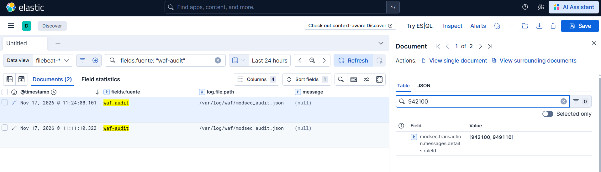
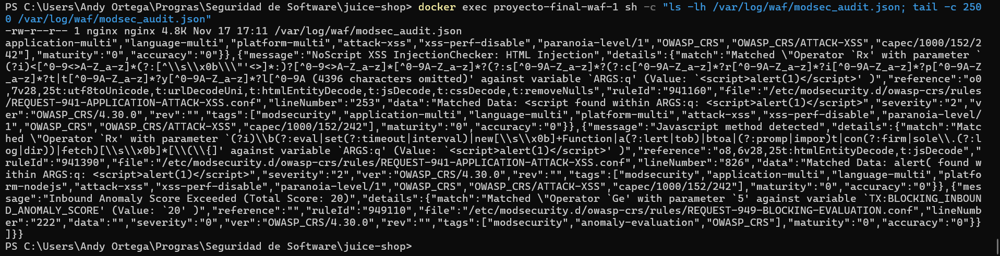
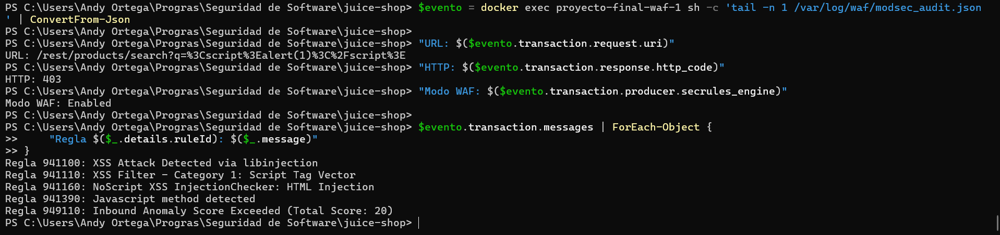
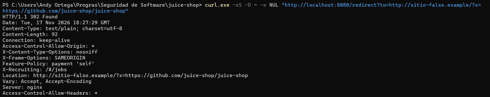
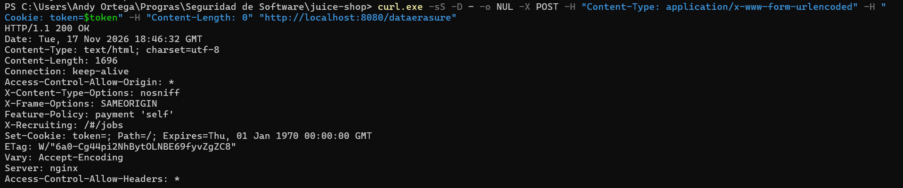
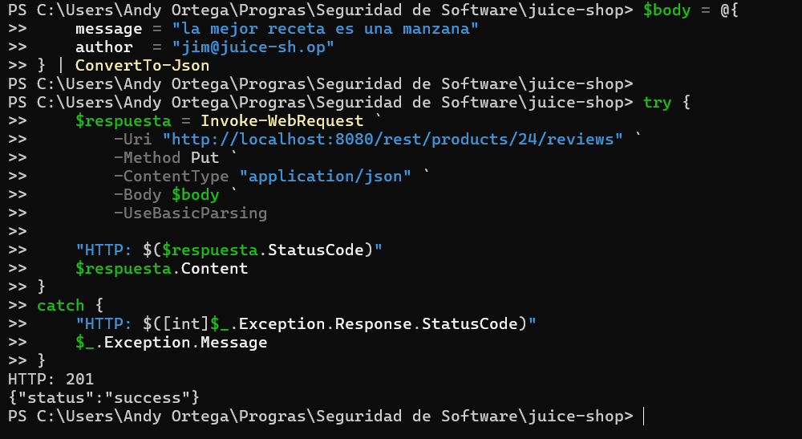
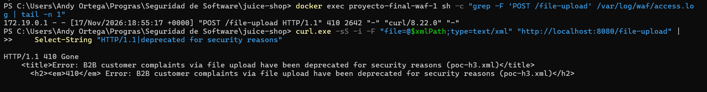

# Hito 3 · Detección y respuesta

> **Nota:** Este archivo reorganiza el contenido del [`README.md`](README.md) actual
> siguiendo el esquema oficial del Hito 3, para comparar ambos. Donde el esquema
> pide algo que el README no cubre, se marca como **⚠ discrepancia/pendiente**.
> El export de Kibana no va aquí: va en `waf-siem/kibana-export.ndjson`
> (en este repo está como [`kibana-dashboard.ndjson`](kibana-dashboard.ndjson)).

## Conexión de la app al WAF

**Opción A — la app solo se alcanza a través del WAF.**

```text
Cliente (127.0.0.1:8080) → Nginx + ModSecurity + OWASP CRS 4.30.0 → Juice Shop (puerto 3000 interno)
```

- El WAF se publica solo en `127.0.0.1:8080`. La imagen de Juice Shop **no publica el puerto 3000** en el host (ver [evidencia 13](evidencias/13-puerto-3000-no-publicado.png)).
- `MODSEC_RULE_ENGINE=On`, `BLOCKING_PARANOIA=1`, `ALLOWED_METHODS=GET HEAD POST OPTIONS PUT`.

**Riesgo aceptado si el puerto original siguiera expuesto:** cualquiera que alcance el `3000` directo evitaría por completo ModSecurity (bypass del WAF). En este laboratorio el `3000` no se publica en el host, pero la evidencia 13 solo prueba que falla desde el loopback de Windows; **no demuestra aislamiento frente a otras redes Docker**. Riesgo residual: bajo en el laboratorio, a confirmar en cualquier despliegue distinto.


## Reglas

Tres detecciones guardadas en Discover. Cada una corresponde a una prueba controlada que dispara una regla real del CRS. El KQL de partida del esquema se ajustó donde el ataque disparó otra familia de reglas.

| Regla | KQL | Ataque que detecta | Captura |
|---|---|---|---|
| DET-01 | `fields.fuente : "waf-audit" and modsec.transaction.messages.details.ruleId : 942*` | SQL Injection en búsqueda (`' OR '1'='1`) → regla `942100` | [evidencia 07](evidencias/07-deteccion-sqli-kibana.png) (y [06](evidencias/06-deteccion-sqli-modsecurity.png) en ModSecurity) |
| DET-02 | `fields.fuente : "waf-audit" and modsec.transaction.messages.details.ruleId : 941*` | XSS en `GET /rest/products/search?q=` (`<script>alert(1)</script>`) → reglas `941100`, `941110`, `941160`, `941390` | [evidencia 05](evidencias/05-deteccion-xss-kibana.png) (y [04](evidencias/04-deteccion-xss-modsecurity.png) en ModSecurity) |
| DET-03 | `fields.fuente : "waf-audit" and modsec.transaction.messages.details.ruleId : 913100` | Firma de herramienta de escaneo (`User-Agent: Nikto/2.5.0`) → regla `913100` | [evidencia 09](evidencias/09-deteccion-escaner-kibana.png) (y [08](evidencias/08-deteccion-escaner-modsecurity.png) en ModSecurity) |

**Capturas de las detecciones**

DET-01 · SQL Injection (`942100`):




DET-02 · XSS (`941*`):




DET-03 · Firma de escáner Nikto (`913100`):


> **DET-03:** el KQL de partida del esquema era `911100` (método no permitido). Se
> cambió a `913100` porque el ataque documentado del Red Team que sí dispara una
> regla propia es la firma de escáner (Nikto), no una violación de método.
>
> ⚠ **Discrepancia a tener en cuenta:** las tres detecciones provienen de **pruebas
> controladas** de XSS/SQLi/escáner, no de las PoC-01 a PoC-04 del Red Team. Esas
> cuatro PoC **no son inyección**, por lo que el CRS las deja pasar y no generan
> alerta de auditoría (ver sección Demo Purple Team y §5 del README).

## Dashboard

**Nombre (según esquema):** `WAF - Blue Team`
⚠ **Discrepancia:** el dashboard real exportado se llama **`Hito 3 - WAF Security Monitoring`** ([`kibana-dashboard.ndjson`](kibana-dashboard.ndjson)). Hay que renombrarlo o aclarar el nombre antes de la entrega.

**Paneles pedidos por el esquema:** eventos en el tiempo · top de reglas · top de rutas · top de IP.

**Paneles existentes (3 de 4):**

| Panel del esquema | ¿Existe? | Panel actual |
|---|---|---|
| Eventos en el tiempo | ✔ | Detecciones a lo largo del tiempo (eventos `waf-audit`) |
| Top de reglas | ✔ | Reglas OWASP CRS activadas (recuento por `ruleId`) |
| Top de rutas | ⚠ falta | — |
| Top de IP | ⚠ falta | — |
| (extra) Eventos por origen | — | `waf-access` / `waf-audit` (24 accesos / 3 auditorías) |

**Captura:**


## Exclusiones

WAF en `MODSEC_RULE_ENGINE=On`. La exclusión es la más pequeña posible y **no apaga el CRS**.

| Regla | Ruta o parámetro | Qué se excluyó | Por qué es legítimo | Archivo |
|---|---|---|---|---|
| `920350` | Encabezado `Host` = `127.0.0.1` (regla local `10001`) | Solo la evaluación de `920350` (Host con IP numérica) para ese Host exacto | El acceso local legítimo del laboratorio usa `Host` con IP numérica (`127.0.0.1:8080`); `920350` lo marcaría como sospechoso | `waf-siem/waf/REQUEST-900-EXCLUSION-RULES-BEFORE-CRS.conf` |

**Prueba de alcance:** `Host: 127.0.0.1:8080` → HTTP 200, sin coincidencia `920350`; `Host: 127.0.0.2:8080` → HTTP 200 y **sí** registró `920350` (17/11/2026 19:44:19). La detección sigue activa fuera de la exclusión.


> ⚠ **Caveat (del README §6):** la excepción `10001` **ya existía** antes de esta
> sesión. No se hizo prueba antes/después que demuestre un falso positivo con
> HTTP 403 corregido; solo se verificó el alcance limitado de la exclusión. Si el
> docente exige evidencia de un falso bloqueo corregido, falta una prueba adicional.

## Demo Purple Team

- **PoC que se repite en vivo:** ⚠ **por acordar.** Candidatas: las cuatro PoC del Red Team revalidadas sobre `20.4.0-SNAPSHOT` (01 Open Redirect · 02 CSRF · 03 Reseñas sin auth · 04 XXE no demostrada). Evidencias crudas en `waf-siem/evidencias/poc_20261117_161550/`.
- **Hora acordada:** ⚠ **pendiente.**
- **Qué muestra el Equipo azul (detección y bloqueo):**
  - **Bloqueo** de las pruebas de inyección en modo `On`: XSS → HTTP 403 y SQLi → HTTP 403.
  - **Correlación en vivo** en Kibana de cada PoC: hora, ruta, payload, estado HTTP e identificador de auditoría si existe.
  - **Aclaración honesta:** las PoC-01 a 04 **no fueron bloqueadas** por el WAF (no son inyección); su mitigación corresponde a la capa de aplicación (Hito 4). Se distingue entre *una solicitud registrada en `access.log`* y *una alerta de auditoría de ModSecurity*.

**Bloqueos en modo `On`:**




**PoC del Red Team (repetidas a través del WAF):**





