# Hito 3 — Detección y respuesta (Blue Team)

**Proyecto Final Integrador: OWASP Juice Shop y Secure SDLC**  
**Rama de trabajo:** `h3-blue-team`  
**Entorno:** laboratorio local con Docker, ModSecurity, OWASP CRS y Elastic Stack.

## 1. Objetivo y alcance

Implementar un **WAF con ModSecurity y OWASP Core Rule Set (CRS)** frente a Juice Shop; enviar los registros mediante **Filebeat → Elasticsearch → Kibana**; desarrollar y verificar **tres reglas propias de detección**; comparar los modos `DetectionOnly` y `On`; analizar y ajustar detecciones no deseadas; y repetir las pruebas compartidas por el Red Team.

> **Limitación de versión:** las pruebas aquí documentadas se efectuaron sobre `bkimminich/juice-shop:v20.3.0`, desplegado en Docker. El repositorio del equipo declara `20.4.0-SNAPSHOT`. Los resultados no deben atribuirse automáticamente al código de esa rama sin repetir las pruebas en la misma versión. El WAF se expone en `127.0.0.1:8080`; el puerto 3000 de Juice Shop no está publicado en el host.

> **Alcance de las detecciones:** las reglas personalizadas `10020`, `10021` y `10022` detectan patrones concretos de pruebas controladas. No implican que las cuatro PoC del Red Team estén bloqueadas ni que las vulnerabilidades de lógica de negocio se hayan corregido.

## 2. Arquitectura y configuración

```text
Cliente local :8080
       |
       v
Nginx + ModSecurity + OWASP CRS 4.30.0
       |                         \
       v                          +--> access.log y modsec_audit.json
Juice Shop v20.3.0                             |
(puerto 3000 interno)                         v
                                          Filebeat 9.3.3
                                               |
                                               v
                                        Elasticsearch 9.3.3
                                               |
                                               v
                                           Kibana 9.3.3
```

Los archivos de despliegue están en `waf-siem/docker-compose.yml`, `waf-siem/filebeat.yml` y `waf-siem/waf/`. El archivo `waf-siem/.env` es **configuración local** y debe mantenerse fuera de Git; para compartir parámetros se utiliza `.env.example`.

Variables del entorno de laboratorio (solo como referencia, **no** sustituir por un `.env` público):

```dotenv
APP_BACKEND=http://juice-shop-h3:3000
WAF_BIND=127.0.0.1
WAF_PORT=8080
MODSEC_RULE_ENGINE=On
ALLOWED_METHODS=GET HEAD POST OPTIONS PUT
BLOCKING_PARANOIA=1
ELASTIC_VERSION=9.3.3
```

Permitir `PUT` en `ALLOWED_METHODS` evita que la PoC de reseñas sea rechazada únicamente por el método HTTP (`911100`); **no corrige** la autorización del backend.

### Archivos de reglas

| Archivo | Propósito | Estado |
|---|---|---|
| `waf-siem/waf/REQUEST-900-EXCLUSION-RULES-BEFORE-CRS.conf` | Exclusiones dinámicas previas al CRS: `10001` (preexistente) y `10030` (ajuste de laboratorio) | Configurado |
| `waf-siem/waf/REQUEST-901-BLUE-TEAM-RULES.conf` | **Reglas propias** `10020`, `10021` y `10022` | Implementadas y verificadas |
| `waf-siem/waf/RESPONSE-999-EXCLUSION-RULES-AFTER-CRS.conf` | Exclusiones posteriores al CRS, solo si el caso lo requiere | Sin exclusiones nuevas |

El `docker-compose.yml` monta los tres archivos en `/etc/modsecurity.d/owasp-crs/rules/`, directorio incluido por la configuración de ModSecurity. Las detecciones no se duplican en archivos de exclusiones.

## 3. Ingesta, dashboard y demostración en Kibana

Se comprobaron los servicios mediante `docker compose -f waf-siem/docker-compose.yml ps`, y las solicitudes a Juice Shop se enviaron a través de `http://localhost:8080`. Nginx escribe los accesos en `/var/log/waf/access.log` y ModSecurity registra las auditorías en `/var/log/waf/modsec_audit.json`.

Filebeat envía los documentos a Elasticsearch (`filebeat-9.3.3`), y en Kibana se utiliza el Data View `filebeat-*`. El dashboard **`Hito 3 - WAF Security Monitoring`** muestra tres paneles:

| Panel actual | Qué representa realmente |
|---|---|
| **Eventos por origen** | Cantidad de documentos por **fuente de log** (`waf-access` y `waf-audit`), no por IP de cliente. El título debe mejorarse en la siguiente edición. |
| **Reglas OWASP CRS activadas** | Recuento de coincidencias por `modsec.transaction.messages.details.ruleId`. Incluye tanto reglas del CRS como nuestras reglas `10020`, `10021` y `10022`; conviene renombrarlo **«Reglas activadas del WAF (CRS y personalizadas)»**. |
| **Detecciones a lo largo del tiempo** | Evolución temporal de los documentos de auditoría de acuerdo con el filtro y período seleccionados. |

**Resultado reciente:** las tres reglas personalizadas `10020`, `10021` y `10022` se observaron en la gráfica de identificadores después de generar tráfico de prueba y pulsar **Refresh** con el rango **Last 24 hours**. La evidencia visual se presenta en la **captura 21**.

**Exportación:** existe un archivo de objetos guardados, [`kibana-dashboard.ndjson`](kibana-dashboard.ndjson), con el dashboard y el Data View relacionado. Se puede importar mediante **Stack Management → Saved Objects → Import** en una instalación compatible. La exportación no contiene los logs ni los contenedores. **Si se cambian títulos o paneles en Kibana, es necesario volver a exportar el NDJSON antes de entregar**; no se da por realizado ese cambio en este documento.

> **Tiempo de los eventos:** `@timestamp` es la marca temporal registrada en la ingesta de Filebeat en este entorno. Para correlacionar una PoC con una detección se deben revisar también la hora de Nginx o el JSON original de auditoría.

## 4. Detecciones implementadas y verificadas

### 4.1. Reglas personalizadas del Blue Team

Las reglas están definidas en **[`REQUEST-901-BLUE-TEAM-RULES.conf`](../../waf-siem/waf/REQUEST-901-BLUE-TEAM-RULES.conf)** y se cargan en ModSecurity desde el volumen montado por Docker Compose.

| ID | Patrón detectado | Campo inspeccionado | Acción | Validación |
|---|---|---|---|---|
| **10020** | Texto con `<script` (firma XSS) | `ARGS:q` | `pass,log,auditlog` | Mensaje `H3 Blue Team - XSS detection` en auditoría y regla visible en Kibana |
| **10021** | Cadena `or '1'='1` (firma SQLi de laboratorio) | `ARGS:q` | `pass,log,auditlog` | Mensaje `H3 Blue Team - SQLi detection` en auditoría y regla visible en Kibana |
| **10022** | Cadena `nikto` (herramienta de escaneo) | `User-Agent` | `pass,log,auditlog` | Mensaje `H3 Blue Team - Scanner detection` en auditoría y regla visible en Kibana |

Estas firmas tienen **alcance limitado**: `10020` y `10021` revisan el parámetro `q`; `10022` revisa el `User-Agent`. No constituyen detectores exhaustivos de XSS, SQLi o escaneo. **Las reglas propias registran la detección, pero no bloquean por sí solas** (`pass`). Los bloqueos HTTP 403 de las pruebas corresponden a las reglas y al puntaje de anomalía de OWASP CRS.

### 4.2. Pruebas controladas con OWASP CRS

| Prueba | Indicador | Reglas CRS observadas | `DetectionOnly` (prueba anterior) | `On` (prueba actual) |
|---|---|---|---|---|
| XSS en `/rest/products/search?q=...` | `<script>alert(1)</script>` | `941100`, `941110`, `941160`, `941390`, `949110` | HTTP 200; anomaly score 20 | **HTTP 403** |
| SQLi en búsqueda | `' OR '1'='1` | `942100`, `949110` | HTTP 200; anomaly score 5 | **HTTP 403** |
| Identificación de escáner | `User-Agent: Nikto/2.5.0` | `913100`, `949110` | HTTP 200; anomaly score 5 | **HTTP 403**, confirmado después |

Ejemplos reproducibles desde PowerShell (solo contra el laboratorio local):

```powershell
# XSS
curl.exe -sS -o NUL -w "XSS HTTP %{http_code}\n" "http://localhost:8080/rest/products/search?q=%3Cscript%3Ealert(1)%3C%2Fscript%3E"

# SQLi
curl.exe -sS -o NUL -w "SQLi HTTP %{http_code}\n" "http://localhost:8080/rest/products/search?q=%27%20OR%20%271%27%3D%271"

# User-Agent de Nikto
curl.exe -sS -o NUL -w "Nikto HTTP %{http_code}\n" -A "Nikto/2.5.0" "http://localhost:8080/"
```

Para mostrar directamente que nuestras reglas están instaladas en el contenedor:

```powershell
docker compose -f waf-siem/docker-compose.yml exec -T waf sh -c 'grep -n "id:1002" /etc/modsecurity.d/owasp-crs/rules/REQUEST-901-BLUE-TEAM-RULES.conf'
```

Se comprobó el funcionamiento posterior a la reorganización de archivos: el WAF quedó **healthy**, la prueba Nikto devolvió **403**, y el evento con ID **10022** se registró correctamente en `modsec_audit.json`.

### 4.3. Detección de ráfagas por IP (ES|QL)

Además de las tres reglas ModSecurity, se creó la consulta [`deteccion-rafagas.esql`](deteccion-rafagas.esql), que agrupa accesos por IP y minuto y selecciona grupos con **10 o más solicitudes/minuto**. En una prueba de laboratorio con 20 solicitudes GET legítimas (HTTP 200), la consulta devolvió **20 eventos de `172.19.0.1`** en el minuto `2026-11-17T19:20:00Z` (captura 18).

La consulta se ejecuta **manualmente**: **no es una alerta automática** ni bloquea tráfico. La IP `172.19.0.1` corresponde al entorno Docker local y no necesariamente al cliente real. El agrupamiento emplea `@timestamp` de ingesta, lo que limita su precisión temporal.

## 5. Validación de las PoC compartidas por el Red Team

Las siguientes pruebas se realizaron con el WAF en modo `On` sobre **Juice Shop v20.3.0**. La PoC-04 comunicada por el Red Team corresponde a **XXE**, no al antiguo caso de bypass del puerto 3000.

| PoC | Solicitud | Respuesta observada | ¿Bloqueó el WAF? | Conclusión |
|---|---|---|---|---|
| **01 — Open Redirect** | `GET /redirect?to=http://sitio-falso.example/?x=https://github.com/juice-shop/juice-shop` | **302 Found** y cabecera `Location` hacia el destino externo de prueba | **No** | La redirección fue emitida; validar destinos en código (H4). No se siguió el enlace externo. |
| **02 — Falta de anti-CSRF** | `POST /dataerasure`, cookie `token` de cuenta de laboratorio y sin token anti-CSRF independiente | **200 OK**; se observó limpieza de cookie | **No** | Se procesó la solicitud, pero no se demostró un ataque entre orígenes desde navegador ni la eliminación efectiva. Requiere validación adicional. |
| **03 — Reseñas sin autenticación** | `PUT /rest/products/24/reviews`, JSON con `message` y `author`, sin token explícito | **201 Created**; `{"status":"success"}` | **No** | La solicitud fue aceptada sin credenciales explícitas; revisar autorización en código (H4). |
| **04 — XXE en carga XML** | `POST /file-upload` con entidad externa hacia `/tmp/xxe-h3.txt` | **410 Gone** | **No; respuesta del backend** | La cadena inocua `XXE_H3_CANARY` no apareció. **XXE no confirmada** en v20.3.0. |

Las solicitudes se observaron en `access.log`, pero **registrar una petición no equivale a detectarla mediante una regla de auditoría**. Estas cuatro PoC todavía requieren correlación explícita entre hora, payload, resultado y evento SIEM para una demostración definitiva. Ninguna de las pruebas descritas demuestra una corrección de las vulnerabilidades de lógica de negocio.

## 6. Análisis de falsos positivos y exclusiones

### 6.1. Exclusión `10001` preexistente

El archivo `REQUEST-900-EXCLUSION-RULES-BEFORE-CRS.conf` **ya contenía** una exclusión con ID `10001`, creada antes del trabajo del equipo, para el encabezado `Host: 127.0.0.1` respecto de la regla CRS `920350` (IP numérica en `Host`). **No se presenta como regla desarrollada por el Blue Team**.

| Solicitud | HTTP | Auditoría observada |
|---|---|---|
| `GET /`, `Host: 127.0.0.1:8080` | 200 | Sin coincidencia `920350` en la prueba |
| `GET /`, `Host: 127.0.0.2:8080` | 200 | Se registró `920350` (captura 19) |

Esta prueba demuestra el **alcance limitado** de la exclusión previa, no la corrección de un bloqueo legítimo confirmado. También se verificó una búsqueda normal `q=apple` con HTTP 200.

### 6.2. Exclusión `10030` desarrollada por el Blue Team — prueba controlada

Se utilizó la búsqueda de laboratorio `GET /rest/products/search?q=union%20select%20juice` para demostrar el análisis y ajuste de una coincidencia del CRS sobre un campo de texto libre. Antes del ajuste, la solicitud devolvía **HTTP 403** a través del WAF y **HTTP 200** al consultar directamente Juice Shop.

La auditoría indicó:

- **`942190`:** coincidencia de `union select` dentro de `ARGS:q` (`Detects SQL code execution and information gathering attempts`).
- **`949110`:** bloqueo por superar el umbral de anomalía (**score 5**). **No se excluye `949110`**.

Se añadió la regla **`10030`** en [`REQUEST-900-EXCLUSION-RULES-BEFORE-CRS.conf`](../../waf-siem/waf/REQUEST-900-EXCLUSION-RULES-BEFORE-CRS.conf). La condición encadenada comprueba **la ruta exacta** `/rest/products/search` y **el valor GET exacto** `union select juice`; si coinciden, retira `ARGS:q` del objetivo de inspección de la regla `942190` para esa solicitud. Las demás reglas del CRS siguen habilitadas.

**Resultados posteriores al ajuste:**

| Prueba | Antes | Después |
|---|---:|---:|
| `q=union select juice` | **403** | **200** |
| `q=union select juice extra` | 403 | **403** |
| `q=' OR '1'='1` | 403 | **403** |

**Riesgo aceptado:** en el caso muy específico que coincide con la condición, el parámetro `q` deja de ser inspeccionado por `942190`, aunque otra regla del CRS podría seguir detectando contenido malicioso. La exclusión no debe generalizarse a otros valores, campos o rutas sin análisis.

> **Limitación esencial:** `union select juice` contiene sintaxis característica de SQLi y fue seleccionada deliberadamente como **escenario controlado de ajuste**, no como incidente de falso positivo observado en usuarios reales. Que el backend responda HTTP 200 no convierte automáticamente la búsqueda en legítima. La práctica demuestra la técnica de exclusión y su alcance; si se exige un falso positivo real confirmado, todavía hace falta documentar un caso legítimo afectado.

El ajuste `ALLOWED_METHODS=... PUT` fue necesario para evaluar la PoC-03 sin confundir un bloqueo por método (`911100`) con la falta de control de autorización. Es un ajuste de política para el laboratorio, no una corrección de código.

## 7. Evidencias visuales integradas

Las imágenes están **incrustadas** mediante rutas relativas a `docs/hito-3/evidencias/`, para que GitHub las muestre directamente al abrir este README. Se deben conservar los archivos PNG con sus nombres exactos en esa carpeta. La numeración sigue el orden en que se generaron las evidencias.

### 7.1. Infraestructura e ingesta

| **01 — Infraestructura Docker** | **02 — Ingesta en Elasticsearch** |
|:---:|:---:|
| 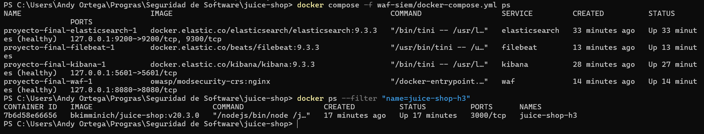 | 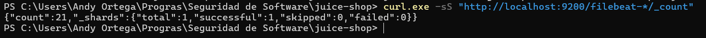 |

| **03 — Accesos en Discover** | **10 — Dashboard original WAF/SIEM** |
|:---:|:---:|
| 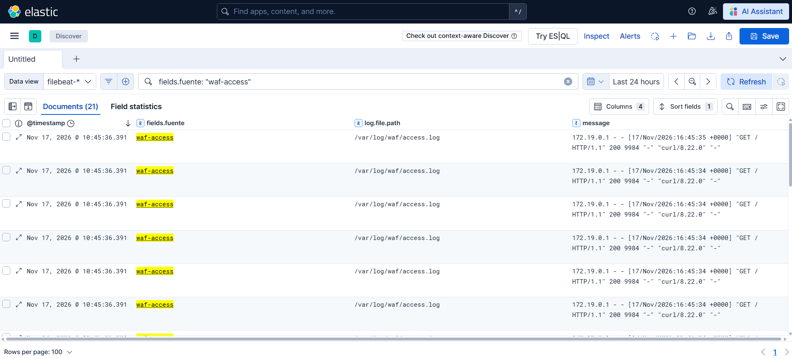 | 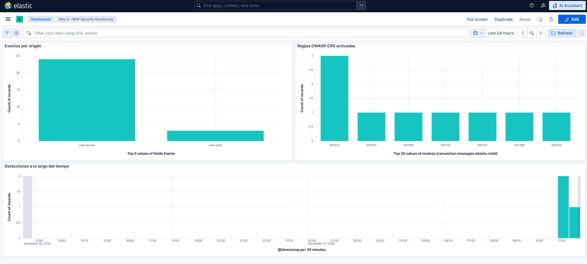 |

### 7.2. Detecciones con OWASP CRS

| **04 — XSS en ModSecurity** | **05 — XSS en Kibana** |
|:---:|:---:|
|  | 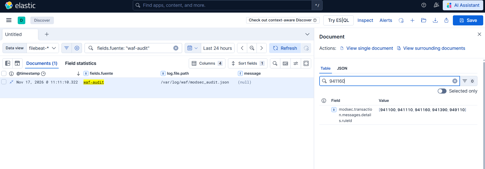 |

| **06 — SQLi en ModSecurity** | **07 — SQLi en Kibana** |
|:---:|:---:|
| 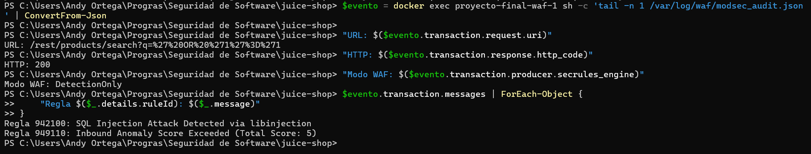 |  |

| **08 — Firma Nikto en ModSecurity** | **09 — Firma Nikto en Kibana** |
|:---:|:---:|
| 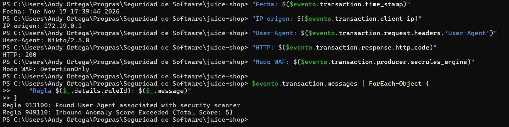 | 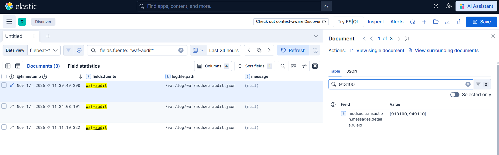 |

| **11 — Bloqueo XSS** | **12 — Bloqueo SQLi** |
|:---:|:---:|
|  | 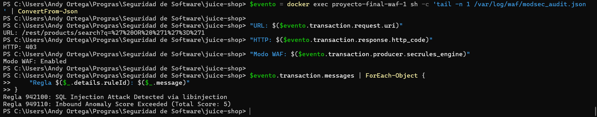 |

### 7.3. Validación de PoC del Red Team y alcance de red

| **13 — Puerto 3000 no publicado** | **14 — PoC-01 Open Redirect** |
|:---:|:---:|
| 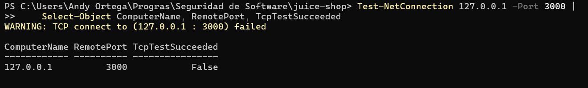 |  |

| **15 — PoC-03 Reseñas** | **16 — PoC-02 CSRF** |
|:---:|:---:|
|  |  |

| **17 — PoC-04 XXE no confirmada** | **18 — Consulta de ráfagas ES/QL** |
|:---:|:---:|
|  | 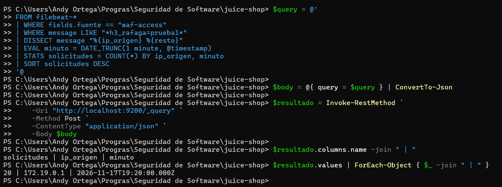 |

### 7.4. Exclusiones y nuestras reglas personalizadas

| **19 — Regla 920350 con Host alternativo** | **20 — Reglas 10020, 10021 y 10022 en ModSecurity** |
|:---:|:---:|
| 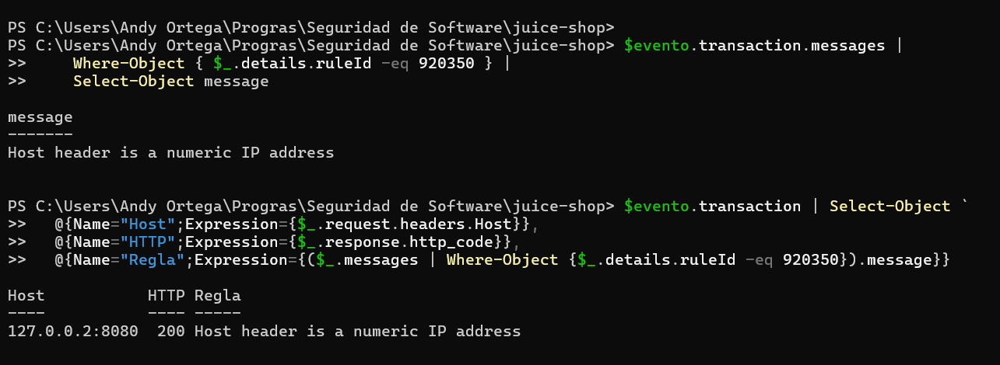 | 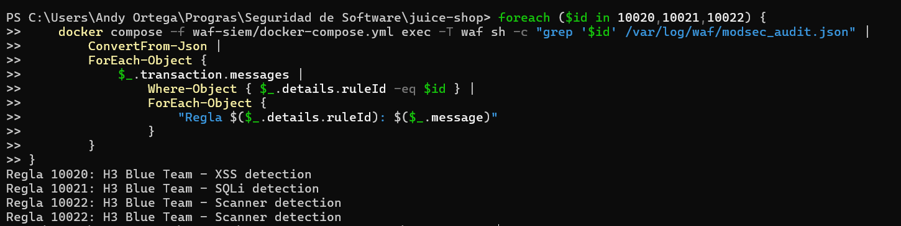 |

| **21 — Tres reglas propias visibles en Kibana** | **22 — Detección Nikto con regla 10022** |
|:---:|:---:|
| 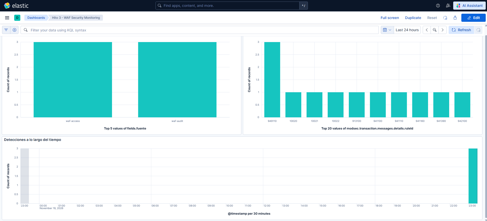 | 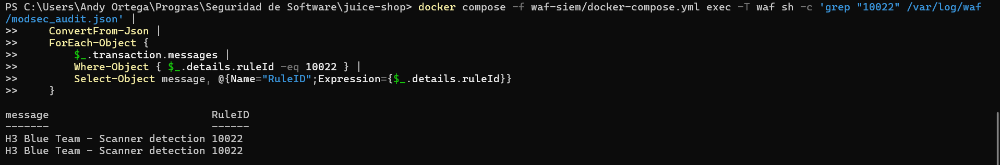 |

**23 — Resultado del ajuste controlado de la exclusión `10030` (HTTP 200 / 403 / 403)**

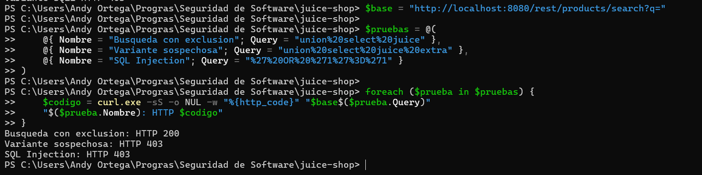

## 8. Guion técnico para la demostración en vivo

Para una revisión directa del catedrático, la secuencia recomendada es **mostrar el archivo → generar la solicitud → observar el registro en Kibana**.

1. **Servicios:** ejecutar `docker compose -f waf-siem/docker-compose.yml ps` y comprobar `waf` y `elasticsearch` saludables; verificar que Kibana responda en `http://localhost:5601`.
2. **Reglas desarrolladas:** abrir `waf-siem/waf/REQUEST-901-BLUE-TEAM-RULES.conf` y señalar los identificadores `10020`, `10021` y `10022`, sus campos y la acción `pass,log,auditlog`.
3. **Prueba:** ejecutar uno de los tres comandos `curl.exe` de la sección 4.2; mostrar HTTP 403 y explicar que el bloqueo corresponde al CRS.
4. **Kibana:** abrir `Hito 3 - WAF Security Monitoring`, seleccionar un rango que incluya la hora de la prueba (por ejemplo, **Last 24 hours**), pulsar **Refresh** y señalar las barras `10020`, `10021` y `10022` en la gráfica de reglas. Si una barra no aparece, revisar el tiempo seleccionado y la ingesta antes de concluir que la regla falló.
5. **Exclusión controlada:** abrir `REQUEST-900-EXCLUSION-RULES-BEFORE-CRS.conf`, mostrar `10030` y explicar que el objetivo excluido es **`ARGS:q` para `942190` bajo condiciones específicas**. Repetir las pruebas 200 / 403 / 403 de la sección 6.2.
6. **Alcance del Red Team:** explicar que las PoC de redirección, CSRF y reseñas no fueron bloqueadas en las pruebas realizadas, y que la XXE no se confirmó; no confundir tráfico en `access.log` con reglas activadas.

**Precaución operativa:** no usar `docker compose down -v`, `docker system prune --volumes` ni restablecer Docker Desktop durante la preparación, porque podría perderse información del SIEM. Conviene iniciar el entorno y comprobar que Kibana carga antes de comenzar la exposición.

## 9. Estado y pendientes de integración

**Completado y verificado:** WAF con OWASP CRS, ingesta hacia Elastic, dashboard, comparación `DetectionOnly`/`On`, tres reglas propias registrando auditorías, consulta manual de ráfagas, exclusión `10030` con pruebas de alcance y recopilación de evidencias de las cuatro PoC compartidas.

**Pendientes relevantes:**

1. **Repositorio:** incorporar los cambios de `docker-compose.yml`, `REQUEST-900`, `REQUEST-901`, este README y las capturas nuevas; revisar `git status` y **no incluir `revision-proyecto.zip`** ni `.env`.
2. **Dashboard:** corregir los títulos que hoy no representan exactamente sus métricas y **reexportar** `kibana-dashboard.ndjson` si se modifica.
3. **Falsos positivos:** `10030` demuestra una exclusión limitada de laboratorio; si la evaluación exige un caso legítimo real bloqueado, debe documentarse aparte y no inventarse.
4. **PoC del Red Team:** volver a ejecutar las cuatro PoC sobre la misma versión de la aplicación del equipo y correlacionarlas con eventos del WAF/SIEM. La PoC XXE sigue sin confirmarse en v20.3.0.
5. **Integración H4:** las vulnerabilidades de lógica de negocio requieren cambios de código, auditoría y repetición de PoC; un 403 del CRS no sustituye una remediación.

## 10. Uso de IA

Se utilizó **ChatGPT** para estructurar pruebas controladas, interpretar resultados y preparar la documentación. Se utilizó **Claude** en el navegador para configurar el Data View `filebeat-*` y el dashboard de Kibana. Las pruebas, configuraciones y conclusiones deben ser revisadas por los integrantes del equipo y citar el uso de IA conforme a las indicaciones de la UVG.
